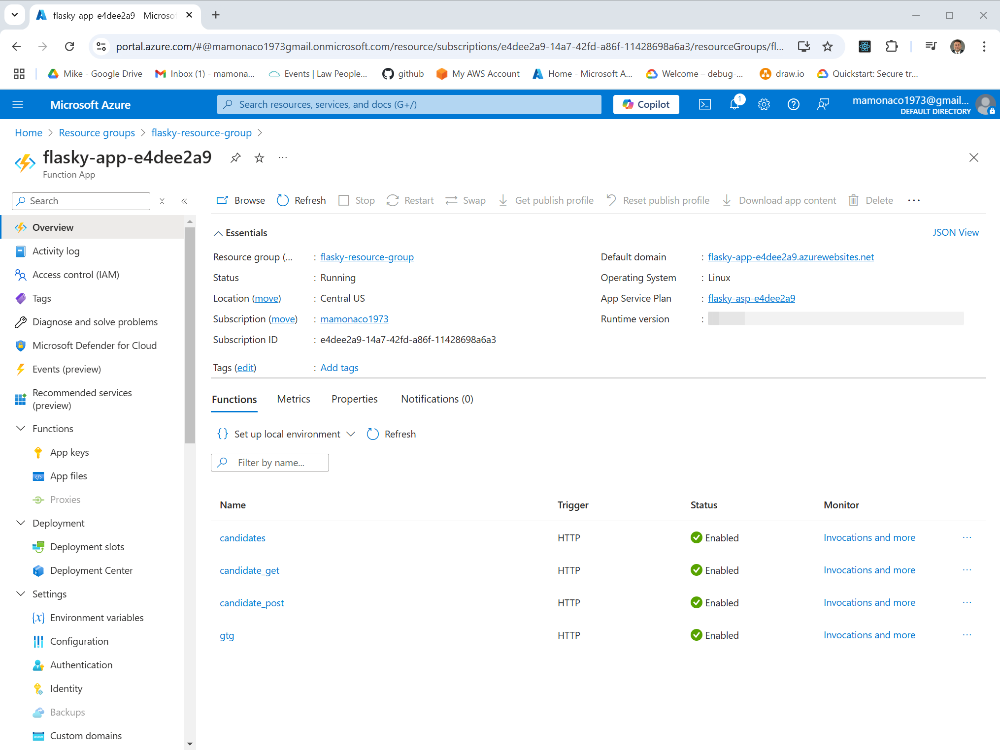
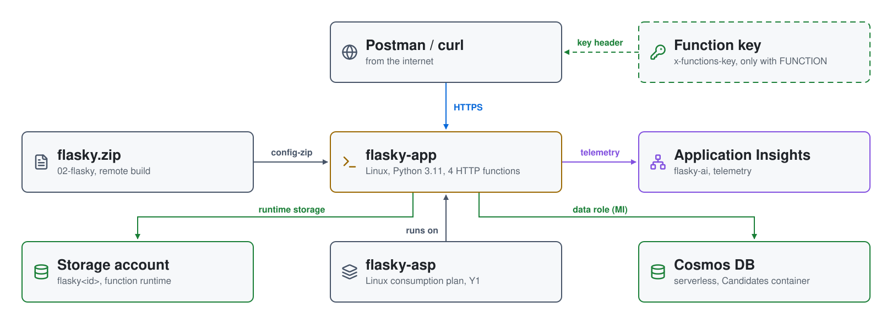
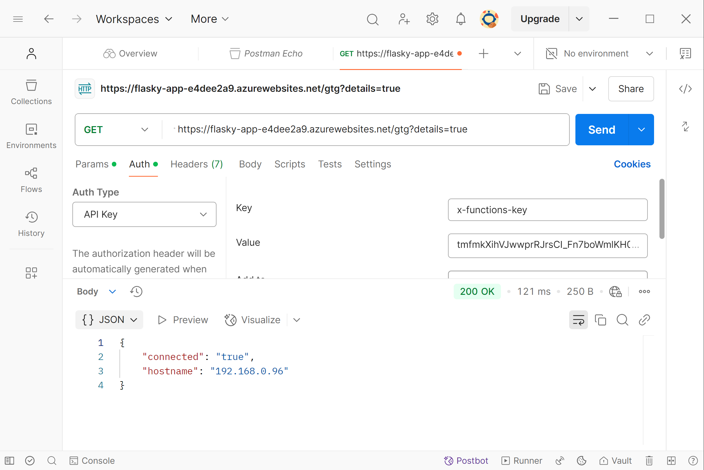

# Serverless Flask-Style API on Azure Functions

The candidate microservice from the
[Azure VM Scale Sets](https://youtu.be/a3l4qUfVvGQ) project, rebuilt without
servers: a **Linux Function App** on the consumption plan serves each
endpoint as a Python HTTP function, and the functions store candidates in
**Cosmos DB** with a managed identity. An optional switch puts the endpoints
behind **function keys**.



| Piece | Where | Role |
|---|---|---|
| **flasky-app-&lt;id&gt;** | `flasky-resource-group` | Linux Function App, Functions runtime `~4`, Python 3.11; four HTTP functions; system-assigned managed identity |
| **flasky-asp-&lt;id&gt;** | `flasky-resource-group` | Linux consumption plan (`Y1`) |
| **Storage account** | `flasky-resource-group` | `flasky<id>`, the Function App's runtime storage |
| **Application Insights** | `flasky-resource-group` | `flasky-ai-<id>`, telemetry |
| **Cosmos DB** | `flasky-resource-group` | serverless `candidates-<id>`, `CandidateDatabase` / `Candidates`, partitioned on `/CandidateName`; a custom data role for the app's identity |

## Architecture

<picture>
  <source media="(prefers-color-scheme: dark)" srcset="architecture-dark.svg">
  
</picture>

Regenerate with `python3 make_diagram.py`.

- **`01-functionapp/`**: the resource group, plan, storage, Application
  Insights, Function App, Cosmos DB and its data role, and the
  `test_candidates` smoke tests.
- **`02-flasky/`**: `function_app.py` (the four functions), `host.json` and
  `requirements.txt`.
- **`add_permissions.sh`**: grants the build's service principal the same
  Cosmos DB data role; `apply.sh` runs it.

## How it builds

1. Terraform builds the resource group, plan, storage, Application Insights,
   Function App and Cosmos DB.
2. `apply.sh` zips `02-flasky` into `flasky.zip` and deploys it with
   `az functionapp deployment source config-zip --build-remote true`, so
   Azure installs `requirements.txt` during deployment.

## API

`host.json` sets `routePrefix` to `""`, so the routes sit at the root, not under the default `/api`.

| Method | Path | Returns |
|---|---|---|
| GET | `/gtg` | 200; with `?details=true`, connection details |
| GET | `/candidate/{name}` | the candidate, or 404 |
| POST | `/candidate/{name}` | `{"CandidateName": <name>}`, or 500 |
| GET | `/candidates` | every candidate, or 404 |

## Prerequisites

* [An Azure Account](https://portal.azure.com/)
* [Install AZ CLI](https://learn.microsoft.com/en-us/cli/azure/install-azure-cli)
* [Install Terraform](https://developer.hashicorp.com/terraform/install)
* `zip`
* [Postman](https://www.postman.com/downloads/) for testing

`check_env.sh` expects a service principal in `ARM_CLIENT_ID`,
`ARM_CLIENT_SECRET`, `ARM_SUBSCRIPTION_ID` and `ARM_TENANT_ID`. If this is
your first time watching our content, we recommend starting with this video:
[Azure + Terraform: Easy Setup](https://youtu.be/wwi3kVgYNOk).

## Deploy

```bash
git clone https://github.com/mamonaco1973/azure-flasky-function-app.git
cd azure-flasky-function-app
./apply.sh       # or .\apply.ps1
```

Everything deploys to `flasky-resource-group`. `apply.sh` ends by running
`validate.sh`, which prints the function key header and runs the smoke test:

```
NOTE: Key header for functions is 'x-functions-key:<key>'
NOTE: URL for API Solution is https://flasky-app-a1b2c3d4.azurewebsites.net/gtg?details=true
✓ good to go passed
✓ insert passed
✓ verification passed
✓ candidate list passed
```

## Try it

1. Call the endpoints with Postman or `curl`, for example
   `curl https://flasky-app-<id>.azurewebsites.net/candidates`.

2. Require function keys. In `01-functionapp/variables.tf`, set
   `authorization_level` to `"FUNCTION"` (the default is `"ANONYMOUS"`) and
   run `./apply.sh` again. `validate.sh` now fails every check with
   `Unauthorized`. Add the header it prints, `x-functions-key: <key>`, to
   your requests in Postman and they succeed again.

   

## Teardown

```bash
./destroy.sh     # or .\destroy.ps1
```

## Notes

- **Lab only.** With the default `authorization_level = "ANONYMOUS"`,
  anyone can call the functions.
